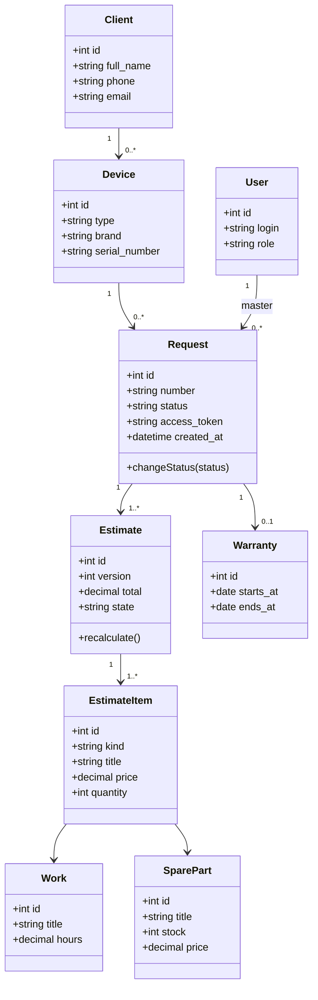
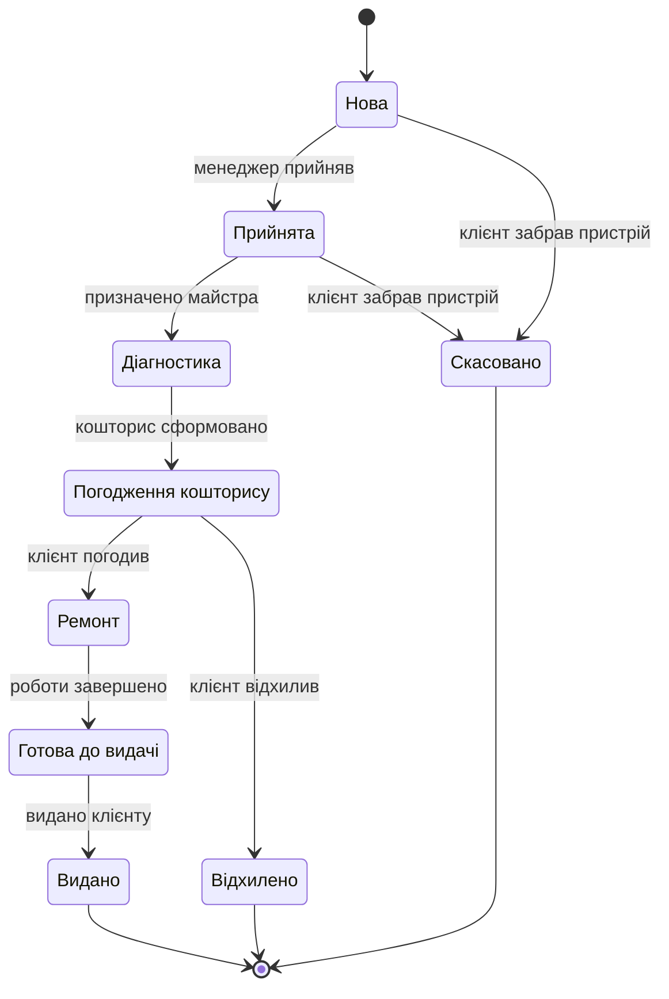
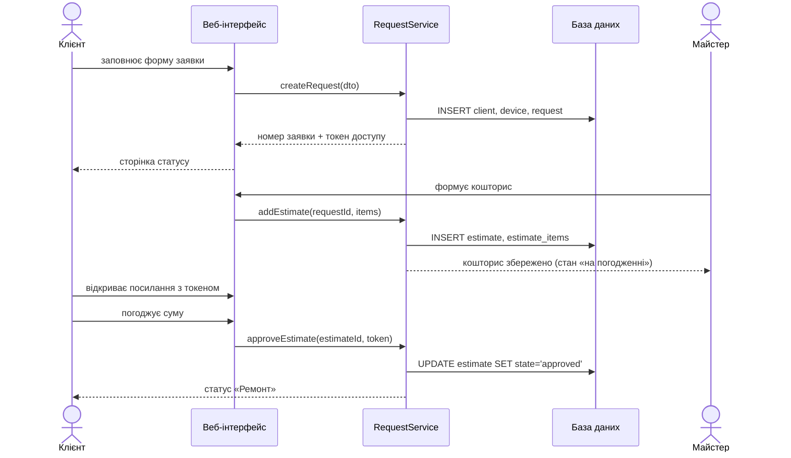

# 03. UML-моделі системи «TechFix»

Моделі описують ту саму предметну область, що й вимоги (`02-requirements.md`): заявка на ремонт,
пристрій, кошторис, роботи й запчастини, гарантія.

## 1. Діаграма варіантів використання

Актори: **Клієнт**, **Майстер**, **Менеджер**, **Адміністратор**.

| Актор | Варіанти використання |
|---|---|
| Клієнт | Подати заявку · Переглянути статус · Погодити кошторис · Відхилити кошторис |
| Майстер | Взяти заявку в роботу · Провести діагностику · Сформувати кошторис · Завершити ремонт |
| Менеджер | Прийняти заявку · Призначити майстра · Оформити видачу · Сформувати звіт |
| Адміністратор | Керувати користувачами · Керувати довідниками · Переглянути журнал дій |

Ключові зв'язки: «Погодити кошторис» розширює «Сформувати кошторис» (include-навпаки: погодження
можливе лише після формування), «Оформити видачу» включає «Сформувати гарантійний талон».

## 2. Діаграма класів (основні сутності)

Пояснення до зв'язків: один клієнт може мати кілька пристроїв; кожна заявка стосується рівно
одного пристрою; кошторис версіонується, тому в заявки їх може бути кілька, але активною є
остання погоджена версія; гарантія створюється лише після видачі.

## 3. Діаграма станів заявки

Заборонені переходи (перевіряються на сервері): «Нова» → «Ремонт», «Діагностика» → «Видано»,
будь-який перехід із кінцевих станів.

## 4. Діаграма послідовності: подання заявки та погодження кошторису

## 5. Діаграма діяльності (спрощена)

Подання заявки → реєстрація пристрою → призначення майстра → діагностика → формування кошторису →
погодження клієнтом (якщо відхилено — закриття заявки) → ремонт → перевірка якості → видача з
гарантійним талоном.
